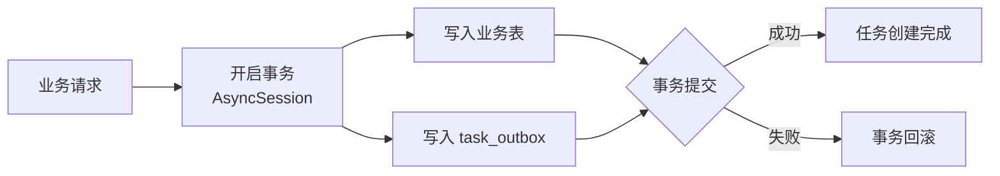

# 创建任务

在业务事务中同时创建业务数据和 `task_outbox`，确保业务提交成功后任务不会丢失（Transactional Outbox）。

## 流程



## 接口

```python
class TaskOutboxService:
    def __init__(self, session: AsyncSession): ...

    async def create(self, dto: CreateTaskOutboxDTO) -> TaskOutboxEntity: ...
```

`CreateTaskOutboxDTO`：

| 字段 | 必填 | 说明 |
| --- | --- | --- |
| `task_name` | 是 | Taskiq 任务名称 |
| `business_id` | 是 | 关联的业务实体 ID |
| `user_id` | 否 | 关联用户 ID |
| `payload` | 是 | 任务参数 dict；禁止包含保留键 `outbox_id` |
| `available_at` | 否 | 最早允许投递时间（延迟投递），默认当前时间 |
| `expires_at` | 否 | 最晚允许投递时间，须晚于 `available_at` |
| `max_publish_attempts` | 否 | 最大投递尝试次数，默认 10 |

调用方式：业务用例在**同一个 `AsyncSession` 事务**内 `TaskOutboxService(session).create(...)`，随业务一起 commit。

## 补充说明

- 创建任务不代表已投递或执行成功；投递由投递流程异步进行。
- 创建时不写 `task_execution`；执行记录在实际开始执行时创建。
- 事务提交成功后，即使投递流程暂时不可用，outbox 记录保留，后续可继续投递。
- `publish_attempts`、`published_at`、`cancelled_at`、`publish_failure` 均由投递流程管理，创建时不设置。
