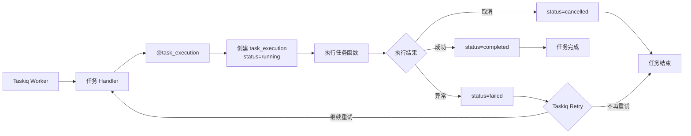

# 执行任务

Taskiq Worker 消费 Redis Stream 并执行任务，`@task_execution` 装饰器负责记录每次实际执行尝试及结果。

## 流程

## 执行记录

- `@task_execution` 是普通 Python 装饰器，不负责任务注册或 Retry；每执行尝试先建 `running` 记录，`attempt` 从 1 递增（`MAX(attempt)+1`）。
- 正常返回 → `completed` 并保存返回值到 `result`。
- 抛异常 → `failed` 保存异常信息后**继续抛出**，由 Taskiq `SimpleRetryMiddleware` 按配置重试（默认 3 次）；重试产生新的 execution 记录。
- 取消 → `cancelled`。
- 任务函数**自行管理数据库 Session 生命周期**（规范约定）：在任务函数内 `async with session_factory() as session:`。

## 参数约定

- `payload` 整体作为单个 dict 参数（参数名 `payload`）传给任务函数，函数内用 pydantic `model_validate` 解析为各自 DTO。
- `outbox_id` 是保留 kwargs，由投递侧附加，`@task_execution` 剥离并使用；DTO / payload 中禁止同名键。

## 可测性约定

- `@task_execution` 装饰器工厂接受注入的 repository 与时钟，单测可用 mock repository 验证三态与 attempt 递增，不依赖数据库。
- 管线级集成测试使用 taskiq 测试模块的 `InMemoryBroker`（任务同步执行），无需 Redis 即可覆盖 outbox → relay → 任务函数 → execution 全链路及 Retry 产生多条 execution 的场景。

## 可靠性

- Redis Stream broker 使用 consumer group（`XREAD` 阻塞消费），未确认消息经 idle timeout claim 兜底重新投递。
- 结合 At-Least-Once 投递，同一任务可能被执行多次，**业务任务必须幂等**（例如以 `business_id` + 状态检查做去重）。
