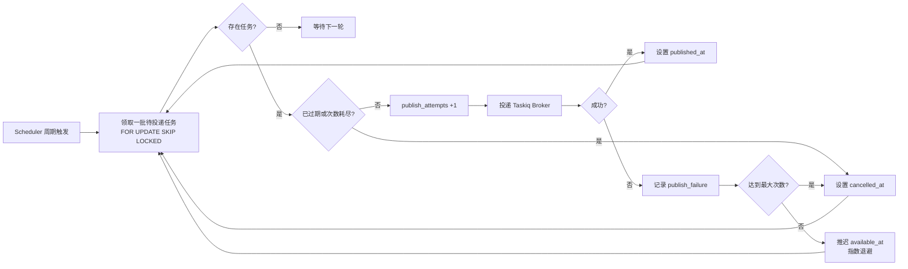

# 投递任务（outbox relay）

投递逻辑封装为 Taskiq 任务 `dispatch_outbox_tasks`，由 Taskiq Scheduler 按固定周期触发，从 `task_outbox` 领取待投递任务并投递到 Taskiq Broker。

## 流程



## 领取与处理

- 领取 SQL（MySQL 8.0+ 支持 `SKIP LOCKED`）：

```sql
SELECT ... FROM task_outbox
WHERE published_at IS NULL
  AND cancelled_at IS NULL
  AND available_at <= NOW(6)
  AND publish_attempts < max_publish_attempts
ORDER BY available_at, id
LIMIT :batch_size
FOR UPDATE SKIP LOCKED;
```

说明：领取**不**按 `expires_at` 过滤——已过期任务必须能被领取到，才能由投递流程标记取消（否则将永远滞留在 pending 状态）。

- 每轮触发按 `batch_size` 分批领取，最多 `max_rounds_per_tick` 轮，避免单轮耗时过长；单轮超过调度周期导致下轮提前触发时，`SKIP LOCKED` 保证不重复处理。
- 领取（短事务，行锁随事务释放）与实际投递（向 Broker 发消息）、状态更新分开，不在等待 Broker 响应期间长期持有行锁。

## 输出

| 情形 | 更新字段 |
| --- | --- |
| 投递成功 | `publish_attempts`、`published_at` |
| 失败且允许重试 | `publish_attempts`、`publish_failure`、`available_at`（退避后时间） |
| 失败且次数耗尽 | `publish_attempts`、`publish_failure`、`cancelled_at` |
| 已过期 | `cancelled_at` |

退避算法：`delay = min(base * 2^(attempts-1), max_delay)`，再加随机抖动。

## 可测性约定

- `TaskRelayService` 构造参数支持注入时钟（`now_fn`）、随机抖动源、Publisher（协议参数），单测可用 fake 替身精确控制时间与投递结果。
- 时间相关逻辑（过期判定、退避时间计算）统一取自注入的时钟，不在内部直接调用 `datetime.now()`。
- 退避计算独立为纯函数，单测断言 `min(base * 2^(n-1), max)` 边界与抖动区间。

## 补充说明

- 调度周期即投递延迟上界，为秒级（默认 5s），不使用分钟级。
- `published_at` 表示成功投递到 Broker，不代表已开始执行或执行成功。
- Broker 投递与 MySQL 状态更新无法组成原子事务，因此为 **At-Least-Once** 语义：极端情况下可能重复投递（已投递成功但 `published_at` 未落库），**任务执行侧必须幂等**。
- Scheduler 可多实例并行：Taskiq Scheduler 本身无分布式锁，多实例安全由 `FOR UPDATE SKIP LOCKED` 保证。
- 过期判定在触发时进行，过期任务的取消最多延迟一个调度周期。
- `task_execution` 不属于投递流程职责，由 Worker 负责创建和更新。
