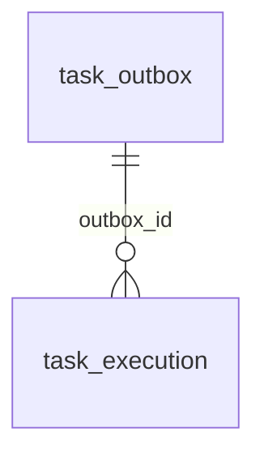

# 任务域表设计



> 本项目尚无用户表，`user_id` 暂为可空字符串（存业务侧用户标识），出现用户表后再评估是否加外键。

## `task_outbox`

只管"有没有成功投递到 Taskiq"。

```sql
CREATE TABLE task_outbox (
    id BIGINT UNSIGNED NOT NULL AUTO_INCREMENT PRIMARY KEY,

    task_name VARCHAR(200) NOT NULL,
    business_id VARCHAR(200) NOT NULL,
    user_id VARCHAR(64) NULL,

    payload JSON NOT NULL,

    -- 最早允许投递时间
    available_at DATETIME(6) NOT NULL DEFAULT CURRENT_TIMESTAMP(6),

    -- 最晚允许投递时间，NULL 表示永不过期
    expires_at DATETIME(6) NULL,

    -- 投递生命周期
    published_at DATETIME(6) NULL,
    cancelled_at DATETIME(6) NULL,

    -- 投递重试
    publish_attempts INT NOT NULL DEFAULT 0,
    max_publish_attempts INT NOT NULL DEFAULT 10,
    publish_failure JSON NULL,

    created_at DATETIME(6) NOT NULL DEFAULT CURRENT_TIMESTAMP(6),
    updated_at DATETIME(6) NOT NULL DEFAULT CURRENT_TIMESTAMP(6) ON UPDATE CURRENT_TIMESTAMP(6)
) ENGINE = InnoDB;

-- 投递轮询：未投递且未取消的任务按 available_at 顺序领取
-- MySQL 不支持部分索引，使用普通复合索引，由查询条件过滤
CREATE INDEX idx_task_outbox_pending ON task_outbox (available_at, id);
```

### 字段说明

| 字段 | 说明 |
| --- | --- |
| `task_name` | Taskiq 任务名称，非空 |
| `business_id` | 业务实体 ID，用于关联产生该任务的业务对象 |
| `user_id` | 创建或关联该任务的用户 ID，可空（支持系统任务） |
| `payload` | 任务参数（JSON 对象，整体作为任务函数的 `payload` 参数） |
| `available_at` | 最早允许投递时间；投递失败后的退避重试也通过推迟该字段实现 |
| `expires_at` | 最晚允许投递时间；NULL 表示永不过期 |
| `published_at` | 成功投递到 Broker 的时间；NULL 表示尚未成功投递 |
| `cancelled_at` | 因过期、投递次数耗尽或主动取消而放弃的时间 |
| `publish_attempts` / `max_publish_attempts` | 已投递尝试次数 / 上限（默认 10），耗尽后取消 |
| `publish_failure` | 最近一次投递失败信息（错误类型、消息） |

### 状态语义（隐式状态，由时间字段表达）

| 状态 | 判定 |
| --- | --- |
| pending | `published_at IS NULL AND cancelled_at IS NULL` |
| published | `published_at IS NOT NULL` |
| cancelled | `cancelled_at IS NOT NULL` |

### 约束策略

约束（`published_at`/`cancelled_at` 互斥、`expires_at > available_at` 等）不依赖数据库 CHECK（OceanBase MySQL 模式对 CHECK 支持有限），改由**应用层（repository / service）保证**。
- `updated_at` 用 MySQL 原生 `ON UPDATE CURRENT_TIMESTAMP(6)`，SQLModel 侧同步 `sa_column_kwargs`，不使用触发器。

## `task_execution`

记录每次实际执行尝试。

```sql
CREATE TABLE task_execution (
    id BIGINT UNSIGNED NOT NULL AUTO_INCREMENT PRIMARY KEY,

    outbox_id BIGINT UNSIGNED NOT NULL,
    attempt INT NOT NULL,
    status VARCHAR(20) NOT NULL DEFAULT 'running',
    result JSON NULL,

    started_at DATETIME(6) NOT NULL DEFAULT CURRENT_TIMESTAMP(6),
    completed_at DATETIME(6) NULL,

    created_at DATETIME(6) NOT NULL DEFAULT CURRENT_TIMESTAMP(6),
    updated_at DATETIME(6) NOT NULL DEFAULT CURRENT_TIMESTAMP(6) ON UPDATE CURRENT_TIMESTAMP(6),

    CONSTRAINT uq_task_execution_outbox_attempt UNIQUE (outbox_id, attempt),
    CONSTRAINT fk_task_execution_outbox
        FOREIGN KEY (outbox_id) REFERENCES task_outbox (id)
) ENGINE = InnoDB;
```

### 字段说明

| 字段 | 说明 |
| --- | --- |
| `outbox_id` | 关联的 `task_outbox.id` |
| `attempt` | 同一 outbox 的第几次执行尝试，从 1 递增；每次 Taskiq 重试创建新记录 |
| `status` | `running` / `completed` / `failed` / `cancelled`，应用层枚举约束 |
| `result` | 执行结果（成功返回值）或错误信息 |
| `started_at` / `completed_at` | 本次尝试起止时间；running 时 `completed_at` 为 NULL |

索引：唯一约束 `uq_task_execution_outbox_attempt` 已覆盖"按 outbox 查执行历史"，无需额外索引。

## SQLModel 映射

模型放 `infrastructure/async_task/`（outbox / execution 各自模块内），并导入 `infrastructure/database/models.py` 供 Alembic 识别；时间列统一 `DateTime(timezone=True)`，复用 `core/datetime` 的工具。
