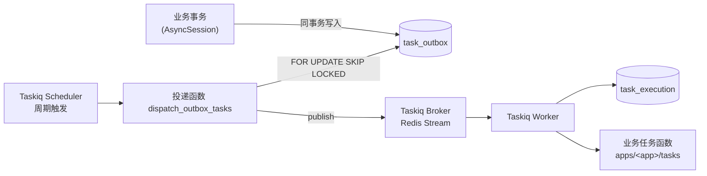
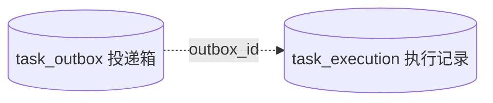

# 异步任务（async-task）基础设施设计

## 一、背景与目标

项目依赖中已有 `taskiq` 与 `taskiq-redis`，Redis 已通过 `infrastructure/cache` 接入，但尚无异步任务基础设施。本设计引入统一的异步任务能力，供业务模块执行耗时或可重试的后台处理，并结合本项目现状（MySQL / SQLModel / AsyncSession）设计。

核心思想：**Transactional Outbox + Taskiq（Redis Stream Broker）**。

- 业务事务内写 `task_outbox`，事务提交成功任务不丢。
- Taskiq Scheduler 周期触发投递函数，将 outbox 任务投递到 Taskiq。
- Taskiq Worker 执行任务，每次尝试记录一条 `task_execution`。
- 投递语义为 **At-Least-Once**，任务执行侧必须幂等。

### 目标

1. 业务模块三步接入一个异步任务（定义 / 注册 / 事务内创建）。
2. 多实例部署安全：投递领取使用 `FOR UPDATE SKIP LOCKED`；Worker 多进程消费同一 consumer group。
3. 投递失败指数退避重试，支持延迟投递（`available_at`）与过期放弃（`expires_at`）。
4. 配置纳入现有 `Settings` 体系（环境变量前缀 `TASKS__`）。

### 非目标（本期不做）

- 任务查询 / 取消的 HTTP API（待业务需求出现另行设计）。
- Cron 类定时任务（Scheduler 仅用于周期触发 outbox 投递）。
- Celery / 其他 Broker 接入（Taskiq + Redis Stream 已够用，待出现新需求再抽象）。

## 二、整体结构



## 三、表设计

两张表：



- `task_outbox`：只管"有没有成功投递到 Taskiq"。
- `task_execution`：记录每次实际执行尝试及结果。

详见 [任务域表设计](./database_design/task_domain.md)。

## 四、核心流程

- [创建任务](./core_process/create_task.md)：业务事务内写 outbox（Transactional Outbox）。
- [投递任务](./core_process/publish_task.md)：Scheduler 周期触发，`SKIP LOCKED` 领取，指数退避，过期/耗尽取消。
- [执行任务](./core_process/execute_task.md)：`@task_execution` 装饰器记录每次执行尝试，重试由 Taskiq 负责。

## 五、目录与文件

遵循 `docs/standards/project_structure.md` 第十章的后台任务布局：

```text
src/backend/
├── infrastructure/async_task/
│   ├── __init__.py          # 对外导出
│   ├── schemas.py           # TasksSettings 总配置
│   ├── outbox/
│   │   ├── repository.py    # create / fetch_pending / mark_* 等数据访问
│   │   ├── service.py       # TaskOutboxService：业务事务内创建任务
│   │   └── dto.py           # CreateTaskOutboxDTO / TaskOutboxEntity
│   ├── execution/
│   │   ├── repository.py    # next_attempt / create_running / finish
│   │   └── schemas.py       # TaskExecutionEntity / TaskExecutionStatus
│   ├── relay/
│   │   └── service.py       # TaskRelayService：领取并投递（过期取消、退避）
│   ├── taskiq/
│   │   ├── broker.py        # build_broker / get_broker（进程级单例）
│   │   ├── publisher.py     # 按任务名直投，附加 outbox_id
│   │   ├── execution.py     # @task_execution 装饰器
│   │   ├── dispatch_task.py # dispatch_outbox_tasks 周期任务
│   │   └── worker.py        # Worker 入口（broker + retry middleware）
│   └── scheduler.py         # Taskiq Scheduler 入口
├── worker/
│   ├── run.py               # 运行入口
│   └── tasks.py             # 导入各业务任务模块，完成任务注册
└── apps/<app>/tasks/        # 业务任务定义
```

说明：不设独立 Dispatcher 进程与 CLI 命令，投递由 Taskiq Scheduler 周期触发；任务注册集中在 `worker/tasks.py`。

## 六、配置设计

`Settings` 新增 `tasks: TasksSettings`，环境变量前缀 `TASKS__`。Redis 连接复用 `cache` 的 `RedisSettings`（同一实例），仅任务专属项放在 `TasksSettings` 下。

| 字段 | 环境变量 | 默认值 | 说明 |
| --- | --- | --- | --- |
| `redis` | `TASKS__REDIS__*` | 复用 `REDIS__*` | Broker 用的 Redis 连接，结构与 `RedisSettings` 一致；未单独配置时默认取 cache 的连接值 |
| `queue_name` | `TASKS__QUEUE_NAME` | `async_task` | Redis Stream 名称 |
| `consumer_group` | `TASKS__CONSUMER_GROUP` | `async_task_group` | consumer group 名称 |
| `max_retry_count` | `TASKS__MAX_RETRY_COUNT` | `3` | Worker 执行失败重试次数（SimpleRetryMiddleware） |
| `relay.poll_interval_seconds` | `TASKS__RELAY__POLL_INTERVAL_SECONDS` | `5` | 投递轮询周期（秒级，不用分钟级） |
| `relay.batch_size` | `TASKS__RELAY__BATCH_SIZE` | `50` | 每批领取条数 |
| `relay.max_rounds_per_tick` | `TASKS__RELAY__MAX_ROUNDS_PER_TICK` | `10` | 单轮触发最大处理批数 |
| `relay.retry_base_delay_seconds` | `TASKS__RELAY__RETRY_BASE_DELAY_SECONDS` | `1` | 投递失败退避基数 |
| `relay.retry_max_delay_seconds` | `TASKS__RELAY__RETRY_MAX_DELAY_SECONDS` | `60` | 退避上限 |

同步更新 `.example.env.d/app.env`。

## 七、运行方式

```bash
# Worker（--workers 指定进程数）
uv run taskiq worker backend.worker.run:broker --workers 4

# Scheduler（周期触发 outbox 投递；可多实例）
uv run taskiq scheduler backend.infrastructure.async_task.scheduler:scheduler
```

- 投递周期决定任务创建到执行的延迟，默认最长约一个轮询周期（5s）。
- Worker 与 Scheduler 均可多实例；不重复投递/执行由 `SKIP LOCKED` 与 Redis Stream consumer group 保证（极端情况下仍可能 At-Least-Once 重复，执行侧幂等）。

## 八、设计决策

| 项 | 决策 |
| --- | --- |
| 数据库适配 | MySQL 8 / OceanBase：`JSON` 列、无部分索引（普通复合索引 + 查询条件过滤）、8.0+ 支持 `FOR UPDATE SKIP LOCKED` |
| 约束校验 | 应用层保证（OceanBase 对 CHECK 支持有限） |
| `updated_at` | MySQL 原生 `ON UPDATE CURRENT_TIMESTAMP(6)`，不用触发器 |
| 投递触发 | Taskiq Scheduler 周期触发，不设独立 Dispatcher 进程 / CLI |
| 任务注册 | `worker/tasks.py` 统一导入 |

## 九、业务任务示例

参见 [业务任务示例](./business_task_example.md)。

## 十、测试计划

可测性约定（详见各流程文档）：投递服务与执行装饰器支持注入时钟（`now_fn`）、随机抖动源、Publisher；管线级测试使用 taskiq 测试模块的 `InMemoryBroker`，无需 Redis。

| 层级 | 内容 |
| --- | --- |
| unit | `TasksSettings` 解析与默认值；DTO 校验（payload 含 `outbox_id` 键拒绝、`expires_at <= available_at` 拒绝、`max_publish_attempts < 1` 拒绝）；退避计算（`min(base * 2^(n-1), max)` 边界与抖动区间）；`@task_execution` 三态、异常上抛、attempt 递增（mock repository） |
| integration（DB，`--with-database`） | outbox 创建与状态流转；`SKIP LOCKED` 并发领取（两个 session 无重叠、总量守恒）；过期/耗尽取消；`(outbox_id, attempt)` 唯一约束 |
| integration（InMemoryBroker 管线） | outbox → relay → 任务函数 → execution 全链路；任务失败 + Retry 产生多条 execution 且 attempt 连续；重复投递（投递成功但 `published_at` 未落库）下任务被执行两次，验证幂等约定 |
| integration（`--with-redis`） | RedisStreamBroker 真实收发；未确认消息 claim 兜底；每次运行使用唯一的 `queue_name` / `consumer_group`（叠加运行 ID 前缀）隔离并清理 |

## 十一、实施步骤

1. 新增迁移：建 `task_outbox` / `task_execution` 表，注册到 `database/models.py`。
2. 新增 `infrastructure/async_task/`（schemas / outbox / execution / relay / taskiq）。
3. 新增 `worker/run.py`、`worker/tasks.py` 与 scheduler 入口。
4. `Settings` 增加 `tasks` 字段，更新 `.example.env.d/app.env`。
5. 补充测试并跑通现有测试。
