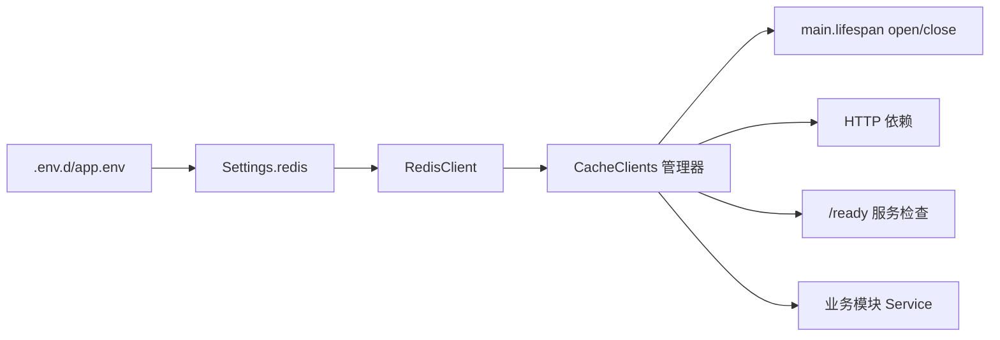

# Cache 基础设施接入设计

## 一、背景与目标

项目依赖中已有 `redis>=8.1.0` 与 `taskiq-redis`，本地 `deployment/dev.docker-compose.yaml` 已提供 Redis 服务（宿主机端口 `6382`），但应用代码层尚未接入。本设计提供统一的缓存基础设施，作为后续业务缓存、会话等能力的基础。结构参考 `slash_space` 项目的 cache 模块实现。

目标：

1. 提供统一的缓存客户端管理器，随应用生命周期启停。
2. 配置纳入现有 `Settings` 体系（pydantic-settings，`.env.d/app.env`）。
3. 服务检查（`/ready`）可探测缓存可用性。
4. 多实例部署安全：客户端按事件循环隔离，key 按环境隔离。

非目标（本期不做）：

- `Cache` 协议抽象与多后端选择（`default_backend`）：当前只有 Redis 一种实现；待出现第二种后端需求时再引入。
- taskiq broker、分布式锁的接入（不属于缓存，各自另行设计）。
- Redis 集群 / Sentinel（当前为单实例）。

## 二、整体结构



## 三、目录与文件

遵循 `docs/standards/project_structure.md` 的技术解耦原则，目录用通用职责名 `cache`，Redis 是内部实现选型：

```text
src/backend/infrastructure/cache/
├── __init__.py      # 对外导出 CacheClients / RedisSettings / build_cache_key
├── clients.py       # CacheClients：客户端管理器（open / ping / close）
├── deps.py          # HTTP 依赖：get_cache_dep / DepCache
├── keys.py          # build_cache_key：key 构建与校验
└── redis/
    ├── client.py    # RedisClient：按事件循环隔离的客户端包装
    └── schemas.py   # RedisSettings
```

## 四、配置设计

在 `Settings` 中新增 `redis: RedisSettings`（配置描述的就是 Redis 连接本身），通过环境变量 `REDIS__*` 覆盖（沿用 `env_nested_delimiter="__"`）。

| 字段 | 环境变量 | 默认值 | 说明 |
| --- | --- | --- | --- |
| `host` | `REDIS__HOST` | `127.0.0.1` | |
| `port` | `REDIS__PORT` | `6382` | 与 docker-compose 端口映射一致 |
| `database` | `REDIS__DATABASE` | `0` | |
| `test_database` | `REDIS__TEST_DATABASE` | `1` | 测试专用 DB 号；经 `.env.d/test_app.env` 覆盖，与数据库的 `DATABASE__TEST_DATABASE` 同一模式 |
| `username` | `REDIS__USERNAME` | `None` | |
| `password` | `REDIS__PASSWORD` | `None` | `SecretStr` |
| `ssl` | `REDIS__SSL` | `false` | |
| `max_connections` | `REDIS__MAX_CONNECTIONS` | `10` | 连接池上限 |
| `socket_connect_timeout` | `REDIS__SOCKET_CONNECT_TIMEOUT` | `3` | 秒 |
| `socket_timeout` | `REDIS__SOCKET_TIMEOUT` | `3` | 秒，避免请求无限等待 |
| `health_check_interval` | `REDIS__HEALTH_CHECK_INTERVAL` | `30` | 秒，连接池自动探活 |
| `key_prefix` | `REDIS__KEY_PREFIX` | `app` | key 统一前缀，校验仅允许字母数字 `._-` |
| `required` | `REDIS__REQUIRED` | `false` | `true` 时启动自检失败则阻止启动 |

同步更新 `.example.env.d/app.env`（含默认注释说明）。

## 五、客户端与生命周期

### RedisClient（`redis/client.py`）

包装 `redis.asyncio.Redis`，核心是**按事件循环隔离**：

| 成员 | 职责 |
| --- | --- |
| `_build_client()` | 按配置构建客户端（惰性连接，构建时不发网络请求） |
| `get_client()` | 取当前运行 loop 对应的客户端，无则构建缓存 |
| `open()` | 获取客户端并 `ping()`（启动自检） |
| `ping()` | 探测可用性，返回 `bool` |
| `close()` | 关闭所有 loop 的客户端并清空 |

按 loop 隔离的原因：测试中每个测试可能运行在不同事件循环，共享单例客户端会导致跨 loop 使用连接的错误。

### CacheClients（`clients.py`）

| 成员 | 职责 |
| --- | --- |
| `redis` / `require_redis()` | 惰性获取 RedisClient，二者等价 |
| `open_all()` | 启动自检；失败时若 `required=true` 则抛出阻止启动，否则记日志降级运行 |
| `close_all()` | 关闭并释放连接池 |

说明：与参考项目不同，本项目 `redis` 配置必填（`RedisSettings` 有完整默认值），不存在"未配置"分支，因此 `require_redis()` 不再抛 `AEServiceUnavailable`，仅保留为显式访问入口。

`Settings` 增加 `PrivateAttr` + `cache_clients` 属性，惰性构建全局管理器实例。

### 生命周期（`main.py`）

```python
@asynccontextmanager
async def lifespan(func_app: FastAPI):
    await settings.cache_clients.open_all()   # required=true 时失败阻止启动
    yield
    await settings.cache_clients.close_all()
```

## 六、使用方式

### HTTP 依赖（`deps.py`）

```python
async def get_cache_dep() -> Redis:
    return await settings.cache_clients.require_redis().get_client()

DepCache: TypeAlias = Annotated[Redis, Depends(get_cache_dep)]
```

同时按现有结构规范在 `presentation/http/deps.py` 转发导出。

### key 构建（`keys.py`）

```python
build_cache_key(prefix, runtime_env, *segments) -> str
```

- 组成：`{prefix}:{runtime_env}:{segment...}`，如 `app:dev:account:user:1`。
- 校验：每个 segment 必须匹配 `^[A-Za-z0-9._-]+$`，否则抛 `ValueError`（防止空格/非法字符导致 key 不可控）。
- `runtime_env` 参与隔离，多环境共用一个 Redis 实例时数据互不污染。

### 业务约定

- 业务模块通过 `DepCache` 或 `settings.cache_clients` 使用；复杂对象自行序列化（如 JSON），序列化工具待真实需求出现时再统一。
- 测试：单测 mock `Redis` 客户端；集成测试连接本地 docker Redis，通过 `.env.d/test_app.env` 的 `REDIS__TEST_DATABASE` 指定独立 DB 号隔离（夹具以 `model_copy(update={"database": test_database})` 派生连接配置），并叠加本次运行唯一的 key 前缀便于清理；通过 pytest 选项 `--with-redis` 门控（配 `requires_redis` marker，未开启则 skip），与数据库测试的 `--with-database` 采用同一约定。测试环境变量统一由 `tests/conftest.py` 设置 `RUNTIME_ENV=test` 后叠加 `test_app.env` 加载。

## 七、服务检查（/ready）

接入现有 `create_health_router` 的就绪检查 `/ready`，将其 `dependencies` 中增加缓存条目：

| 项 | 方案 |
| --- | --- |
| 探测命令 | `cache_clients.require_redis().ping()`（复用连接池，受 `READINESS_TIMEOUT_SECONDS` / `socket_timeout` 约束） |
| 可用 | `dependencies["cache"] = "ok"` |
| 不可用 | `dependencies["cache"] = "unavailable"`，由现有逻辑汇总为 `unavailable` / `degraded` 并返回 503 |
| 启动行为 | `open_all()` 自检；`required=false` 时失败仅降级，运行期可用性由 `/ready` 反映 |

## 八、测试计划

| 层级 | 内容 |
| --- | --- |
| unit | `RedisSettings` 默认值、`key_prefix` 校验、环境变量覆盖解析；`build_cache_key` 拼接与非法 segment；`RedisClient` 参数透传 |
| integration | 连接本地 docker Redis 执行 set/get/ping；`CacheClients` open/close 与 `required` 行为；不同事件循环取到不同客户端（`--with-redis` 门控，`requires_redis` marker） |
| e2e | `/ready` 返回 `cache` 依赖状态 |

## 九、实施步骤

1. 新增 `infrastructure/cache/`（schemas / client / clients / keys / deps + settings 字段）。
2. 更新 `main.py` lifespan、`presentation/http/deps.py`、`/ready` 探测。
3. 更新 `.example.env.d/app.env`。
4. 补充测试并跑通现有测试。
