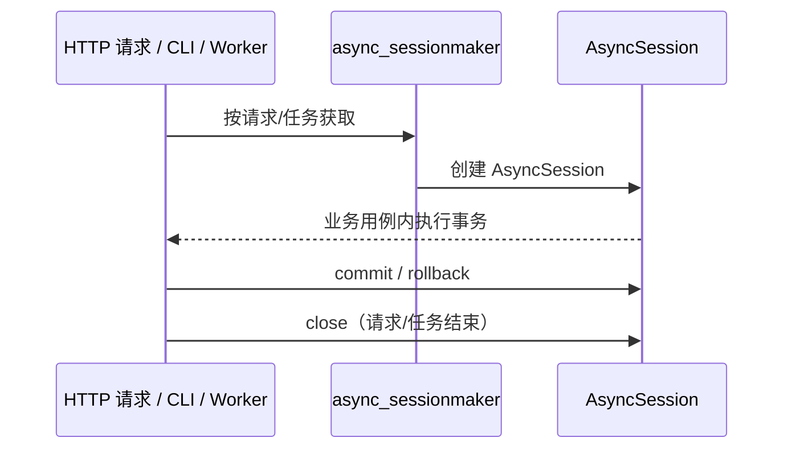

# 数据库基础设施设计

为 backend 接入数据库基础设施：本地开发使用 MySQL（docker-compose 已提供 `mysql:8.4`，映射 `127.0.0.1:3307`），共享与生产环境使用 OceanBase MySQL 模式。两者协议兼容，代码与迁移脚本不区分目标库，遵循 [数据库规范](../../../standards/database.md) 与 [目录结构规范](../../../standards/project_structure.md)。

## 1. 现状与目标

| 项 | 现状 | 目标 |
|---|---|---|
| 依赖 | 无 SQLModel / SQLAlchemy / Alembic | `pyproject.toml` 新增依赖 |
| 目录 | 无 `infrastructure/database/` | 建立 engine / session / base / models |
| 迁移 | 无 `migrations/` | Alembic 初始化，模型统一注册 |
| 配置 | 无数据库配置 | `DatabaseSettings` 接入 `Settings` |
| 测试 | 无数据库测试夹具 | 集成测试夹具（专用测试库 + 迁移建结构 + 清理） |

## 2. 依赖选型

| 包 | 用途 |
|---|---|
| `sqlmodel` | 数据模型定义（含 SQLAlchemy） |
| `alembic` | 数据库结构迁移 |
| `asyncmy` | MySQL 协议异步驱动（OceanBase MySQL 模式兼容） |

驱动选型说明：项目为全异步栈（FastAPI + async redis），数据库访问使用 SQLAlchemy async engine，避免同步驱动阻塞事件循环。

## 3. 目录结构

```text
backend/
├── migrations/                          # 新增：Alembic 迁移
│   ├── versions/
│   ├── env.py
│   └── script.py.mako
├── alembic.ini                          # 新增
└── src/backend/infrastructure/database/ # 新增
    ├── __init__.py
    ├── engine.py                        # Engine 构建（全局复用）
    ├── session.py                       # SessionFactory 与生命周期辅助
    ├── base.py                          # 自定义类型与公共列工具
    └── models.py                        # 业务模型统一注册（供 Alembic）
```

## 4. 配置设计

新增 `DatabaseSettings`，接入 `Settings`，环境变量前缀 `DATABASE__`（与 Redis 的 `REDIS__` 风格一致）：

| 字段 | 默认值 | 说明 |
|---|---|---|
| `host` | `127.0.0.1` | 主机 |
| `port` | `3307` | 默认对准本地 MySQL（docker-compose 端口映射）；其他环境覆盖 |
| `user` | `app` | 用户 |
| `password` | `""` | 密码 |
| `database` | `app` | 库名 |
| `test_database` | `app_test` | 测试库名，供 `create_test_engine()` 派生测试 Engine |
| `pool_size` | `10` | 连接池大小 |
| `max_overflow` | `20` | 溢出连接数 |
| `pool_recycle` | `1800` | 连接回收秒数 |
| `pool_pre_ping` | `True` | 取连接前探活 |
| `echo` | `False` | SQL 回显（仅排查用） |

`engine.py` 提供 `create_async_engine(database: DatabaseSettings) -> AsyncEngine`，URL 形如 `mysql+asyncmy://...`，统一附加 `charset=utf8mb4`。Engine 全局单例（挂在 `Settings` 私有属性上，与 `cache_clients` 同模式）；`main.py` lifespan 关闭阶段执行 `await engine.dispose()` 释放连接池。

## 5. Session 生命周期



- `session.py` 提供 `create_session_factory(engine) -> async_sessionmaker[AsyncSession]` 与 `get_session()` 异步 FastAPI 依赖（`async yield`，结束时 rollback + close，业务用例内自行 commit）。
- Session 按请求或任务创建，不跨请求共享、不作为任务参数传递。
- 事务边界由业务用例（`apps/*/services.py`）控制，基础设施不隐式提交。

## 6. base.py：公共类型与列

- `GUID` 自定义类型：Python `uuid.UUID` ↔ MySQL `BINARY(16)`，实现 `TypeDecorator`。
- `uuid7()` 工具函数：应用层生成 UUIDv7 主键默认值。Python 3.14 直接使用标准库 `uuid.uuid7`；如需兼容更低版本，引入 `uuid-utils` 兜底（或将项目 Python 下限提至 3.14）。
- `utc_now()`：应用层 UTC 时间工具（复用 `core/datetime.py` 若已有，避免重复）。

业务模型通过 SQLModel 继承使用；`created_at` / `updated_at` 由模型显式声明（`DATETIME(6)`，见规范），`updated_at` 触发器由迁移脚本创建。

## 7. Alembic 接入

- `migrations/env.py` 导入 `backend.infrastructure.database.models`，`target_metadata = SQLModel.metadata`；采用 Alembic async 模板（`asyncio.run` + `connection.run_sync`）。
- `alembic.ini` 的数据库 URL 从环境变量 / `DatabaseSettings` 读取，不写入明文密码（`env.py` 内通过 settings 组装）。
- 新增 app 模型后：在 `models.py` 注册 → `alembic revision --autogenerate` → 人工检查修正（命名遵循 `pk_`/`fk_`/`uk_`/`idx_`/`trg_` 规范，触发器显式手写）。
- 迁移操作统一使用 Alembic 原生 CLI（在 `backend/` 目录下执行，如 `alembic upgrade head`），不经 `manage.py` 封装；`env.py` 内通过 `Settings` 组装连接配置，入口无关。将来出现需要编排的场景（迁移前检查、备份、升级一条龙）再按需增加 CLI 薄封装。

## 8. 本地与测试环境

### 环境差异

| 环境 | 数据库 | 说明 |
|---|---|---|
| 本地 / 测试 | MySQL 8.4（docker-compose） | 默认配置直连 `127.0.0.1:3307` |
| 共享 / 生产 | OceanBase MySQL 模式 | 通过 `DATABASE__HOST/PORT` 等覆盖 |

- 本地：`.env.d/mysql.env` 已有（docker-compose 启动 `mysql:8.4`），`app.env` 增加 `DATABASE__*` 配置（默认值即对准本地 MySQL），`.example.env.d/app.env` 同步示例。
- 共享/生产：OceanBase 通过环境变量覆盖连接参数；迁移脚本需使用 OceanBase 兼容语法，上线前在 OceanBase 验证（见规范要求）。
- 集成测试：使用专用测试库，不与本地开发库混用。参照 slash_space 的既有实践：
  - 测试库名通过 `DatabaseSettings.test_database` 显式配置（环境变量 `DATABASE__TEST_DATABASE`，如 `app_test`）；`engine.py` 提供 `create_test_engine()`，以 `model_copy(update={"database": test_database})` 派生测试 Engine，派生逻辑沉淀在基础设施内，测试代码不手工拼配置。
  - 真实数据库集成测试通过 pytest 选项 `--with-database` 门控（配 `requires_database` marker）：未开启时 skip，保证无数据库环境也能跑全量测试。
  - 测试前后清理 `get_settings()` 的 `lru_cache`，避免环境变量调整被缓存污染。
  - 不采用 slash_space 的单连接事务回滚引擎方案：其依赖 psycopg 裸连接的自封装，在 SQLAlchemy async engine + asyncmy 下会破坏 e2e 真实连接语义，维持 TRUNCATE 清理。
  - 结构初始化（会话级一次）：`tests/conftest.py` 夹具在会话开始时创建测试库（已存在则 DROP 重建），然后执行 `alembic upgrade head` 建结构（含触发器等迁移对象，同时验证迁移可执行）。不使用 `create_all`：它建不出触发器，会导致 `updated_at` 语义在测试中失效、测试结构与迁移历史不一致。
  - 数据清理（每测试函数）：测试结束后 `TRUNCATE` 相关表（`SET FOREIGN_KEY_CHECKS=0`，恢复自增计数），毫秒级完成，保证真实提交路径被验证。基础数据表清空后由 seed 重灌。
  - 初始数据分两类：
    | 类型 | 处理方式 |
    |---|---|
    | 基础数据（seed，如默认角色、字典） | 各 app 提供幂等 `seed()` 函数，统一注册（与 `models.py` 注册方式对齐）；会话夹具建表后执行，开发环境初始化复用同一函数（如 CLI `db seed`）。以代码定义，不用 SQL dump。 |
    | 测试数据 | 测试内通过 `tests/factories/` 按需构造，不预置，保证用例自含、数据前提可读。 |
  - 不采用整体事务回滚 / SAVEPOINT 嵌套作为全局隔离机制：HTTP e2e 测试由应用侧 Session 自行连接并 commit，外部事务无法覆盖；`updated_at` 触发器与唯一约束也依赖真实提交语义。service 级测试如需提速，可按需局部引入回滚隔离，不作为全局约定。

## 9. 实施步骤

1. `pyproject.toml` 新增依赖并安装（确认当前平台有 asyncmy 预编译 wheel）。
2. 实现 `infrastructure/database/`（base → engine → session → models）。
3. `DatabaseSettings` 接入 `Settings`；env 示例更新。
4. 初始化 Alembic（`alembic.ini`、`migrations/`）并生成空基线迁移。
5. 测试夹具与最小集成测试（连接探活 + 建库/迁移/清理验证）。
6. `main.py` lifespan 增加 engine dispose。

## 10. 边界与非目标

- 不在本次实现任何业务表模型；`models.py` 仅预留注册入口。
- 不引入 Repository 基类等额外抽象（按目录结构规范"按需引入"）。
- 生产迁移执行流程（CI/CD 集成）另行设计。
