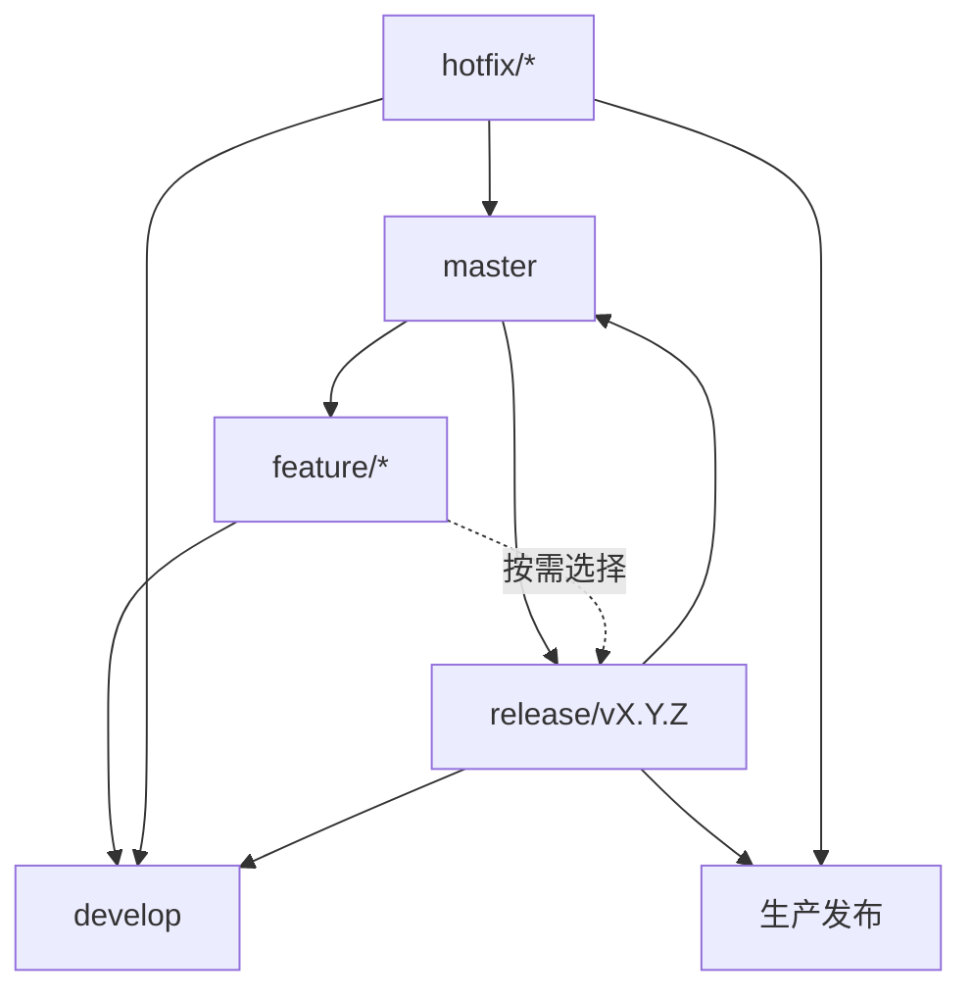

# 分支规范

仓库采用 `master + develop` 模式，使用独立的 `release/*` 分支管理选择性发布。`release/*` 合入 `master` 即视为一次生产发布。

## 分支类型

| 分支类型 | 命名规则 | 用途 | 要求 |
| --- | --- | --- | --- |
| 主干分支 | `master` | 生产发布基线 | 保持可发布，只接受来自 `release/*` 和 `hotfix/*` 的合并，与仓库设置中「分支设置」的默认分支保持一致 |
| 开发分支 | `develop` | 日常集成与验收 | 用于集成多个功能分支，可包含尚未发布的功能，永远是功能最全最新 |
| 功能分支 | `feature/*` | 独立功能开发 | 一般一个事项卡对应一个功能分支，默认从 `master` 创建，通过 PR 合并 |
| 发布分支 | `release/vX.Y.Z` | 选择性发布与版本收口 | 从 `master` 创建，只包含本次发布需要的变更 |
| 热修复分支 | `hotfix/*` | 生产紧急修复 | 从 `master` 创建，优先修复生产问题 |

- 只允许创建上表中规定类型的分支，禁止创建规定类型以外的分支。
- 禁止直接在 `master` 和 `develop` 上开发。
- 短期分支完成合并后删除，不作为长期开发分支复用。

## 命名

功能、发布、热修复分支使用以下格式：

```text
<type>/<scope>[-<summary>]
```

- 仅使用小写字母、数字和 `-`。
- `scope` 表示应用、模块或变更范围。
- `summary` 使用简短英文描述目标，可以省略。
- 不添加日期、开发者名称或无意义编号。

| 类型 | 用途 | 示例 |
| --- | --- | --- |
| `feature` | 新功能 | `feature/account-login` |
| `release` | 发布准备 | `release/v1.2.0` |
| `hotfix` | 生产紧急修复 | `hotfix/account-login-timeout` |

发布分支使用 `release/v<version>` 格式，版本号遵循语义化版本规范 `MAJOR.MINOR.PATCH`。

## 分支关系



- `develop` 不直接合入 `master` 或 `release/*`。
- 生产发布只通过 `release/*` 或 `hotfix/*` 合入 `master` 触发。

## 工作流

### 日常开发

```text
master → feature/* → PR → develop
```

1. 从最新 `master` 创建功能分支。
2. 完成单一目标，并通过必要的自动化检查。
3. 提交 PR 合入 `develop`，进行集成验证。
4. 合并后删除功能分支。

合入 `develop` 不代表变更自动进入生产发布。

如果功能依赖其他尚未合入的变更，应明确依赖关系，避免将无关提交带入目标分支。必要时，可以基于依赖分支开发，并在合并前整理提交或解决依赖问题。

### 发布

```text
master → release/v<version>
             ↑
       按需选择变更
             ↓
release/v<version> → master（生产发布）
             ↓
          develop
```

1. 从当前 `master` 的最新正式发布提交创建 `release/v<version>`。
2. 根据本次发布范围，将需要发布的功能分支或修复分支合入 `release`。
3. 检查功能依赖、数据库迁移、配置兼容性及整体集成情况。
4. 执行必要的自动化测试、集成测试和发布验收。
5. 发布阻断问题应在 `release` 上修复，并及时同步到其他受影响的分支。
6. 验收通过后，通过 PR 将 `release` 合入 `master`，完成本次生产发布。
7. 确认发布完成后，将 `release` 同步回 `develop`，并删除发布分支。

发布分支只允许纳入本次发布所必需的内容，包括：

- 本次发布明确选择的功能和缺陷修复。
- 发布阻断问题修复。
- 版本号、发布文档及必要的配置调整。

不得将未经选择和验证的 `develop` 整体合入 `release`。

合入 `release` 前，必须确认变更基于正确的代码版本，不会意外引入其他未发布功能。若功能分支包含无关提交，应通过整理提交或 `cherry-pick` 精确选择需要的变更。

### 紧急修复

```text
master → hotfix/* → master（生产发布）
                       └→ develop
```

1. 从当前生产版本对应的 `master` 提交创建 `hotfix/*`。
2. 完成修复和回归测试后，通过 PR 合入 `master`，发布新的补丁版本。
3. 将修复同步到 `develop`。
4. 如果存在受影响的 `release/*`，也必须同步修复。
5. 确认修复已同步后删除热修复分支。

## 发布与回滚

- 生产部署以 `master` 上通过发布验收的提交为准。
- CI/CD 应校验合并来源和发布条件，避免未经发布流程的变更触发生产部署。
- 部署失败时，应保留失败记录，并根据部署平台的回滚机制恢复到已知可用版本。
- 需要修复已发布版本时，通过 `hotfix/*` 创建新的补丁版本，不移动已有发布历史。

## PR 与合并

- PR 标题准确描述目标，正文说明变更内容、测试结果和潜在风险。
- 接口、配置、部署方式或业务行为发生变化时，必须同步更新文档。
- 缺陷修复应包含回归测试；无法补充时，必须在 PR 中说明原因。
- 合并前解决目标分支上的冲突，并重新执行受影响的检查。
- 功能分支合入 `develop` 或 `release` 时，默认使用 Squash merge。
- `release` 合入 `master` 时，优先使用 Merge commit，保留发布边界和合并历史。
- 合入 `master` 时，必须说明发布范围、验证结果和回退方式。
- 未通过必要检查或尚未完成评审的 PR 不得合并。
- 发布修复必须同步到所有受影响的分支，不能只修复当前发布分支。

## 分支保护

- `master`：禁止直接推送；必须通过 PR 合并；必要的 CI 检查必须通过。
- `develop`：禁止直接推送；必须通过 PR 合并；必要的 CI 检查必须通过。
- `release/*`：禁止直接推送；通过 PR 纳入变更；发布验收检查必须通过。
- 短期分支：根据需要执行 CI 检查，合并后删除。

多人协作时，应为重要分支配置必要的 PR 审批规则。具体规则通过仓库平台的 Branch protection rules 或 Repository rulesets 实施。

## 禁止事项

- 直接在 `master` 或 `develop` 上开发。
- 创建规定类型以外的分支。
- 未经选择，将 `develop` 整体合入 `release` 或 `master`。
- 将未经审核或未完成必要验证的变更合入 `release`。
- 将包含无关提交的功能分支直接合入 `release`，导致发布范围失控。
- 在一个分支中混合无关功能、重构和格式化。
- 使用 `test`、`fix1`、`new-branch`、`temp/*` 等模糊名称。
- 使用中文、空格或下划线命名分支。
- 将 `master`、`develop` 或 `release/*` 作为个人长期开发分支。
- 合并后继续复用已经关闭的短期分支。
- 仅修改 `release` 上的修复，却未同步到其他受影响的分支。
