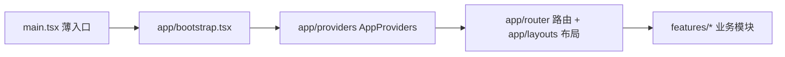

# 前端设计总览

## 简要说明

前端为 React + Vite 单页应用，技术栈：TanStack Router / Query、zustand、sonner。
目录结构遵循 `docs/standards/project_structure.md`（feature-based + layer-based）。
后端 API 层根据 `openapi/api.json` 快照由 orval 自动生成，业务代码只使用
`features/*/api/` 封装的调用与 hooks，不直接调用 `fetch`。

## 应用骨架

## 后端 API 层

```mermaid
flowchart LR
    A[FastAPI 后端] -->|openapi.json| B[openapi/api.json 快照]
    B -->|orval| C[src/generated]
    C --> D[features/&#42;/api 业务封装]
    D --> E[src/services/http/request.ts]
    E --> A
    F[src/services/http/query-client.ts] --> D
```

| 文件 | 职责 |
| --- | --- |
| `openapi/api.json` | 后端 OpenAPI 快照，由 `npm run api:sync` 拉取 |
| `orval.config.ts` | orval 配置：`react-query` client + `fetch`，`single` 集中生成模式 |
| `src/generated/api/` | 生成的请求函数与 Query/Mutation hooks，禁止手工修改 |
| `src/generated/models/` | 生成的数据模型 |
| `src/services/http/request.ts` | orval mutator：拼接 `config.apiBaseUrl`、注入请求头、统一解析响应与错误 |
| `src/services/http/error.ts` | `ApiError` 类型（status/code/message/metadata） |
| `src/services/http/query-client.ts` | QueryClient 工厂：staleTime、重试策略、全局错误 toast（sonner） |
| `features/*/api/` | 业务接口封装，模块通过 `index.ts` 对外导出 |

### 命令

| 命令 | 作用 |
| --- | --- |
| `npm run api:sync` | 从后端拉取 OpenAPI 文档到 `openapi/api.json`（`OPENAPI_URL` 可覆盖，默认 `http://localhost:8000/openapi.json`） |
| `npm run api:generate` | 运行 orval 重新生成 `src/generated/` |
| `npm run api:update` | sync + generate |
| `npm run api:check` | 生成后校验 generated 目录无未提交变更（CI 用） |

### 错误约定

后端统一错误响应为 `{code, message, metadata}`（见 `../../../../../backend/src/errors/handlers.py`），
`request.ts` 将其解析为 `ApiError`。Query/Mutation 层面：仅 5xx 与网络错误重试
（最多 2 次）；4xx 不弹全局 toast，由业务自行处理；5xx 与网络错误通过 sonner
toast 提示。

### 部署

API 地址通过 `src/config/` 读取（`runtime-config.js` > `VITE_API_BASE_URL` > 默认空，
即同源部署）。
