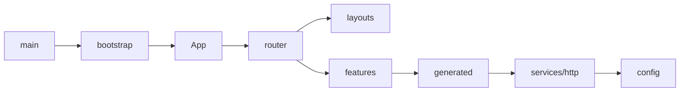

# 前端目录结构重做设计（2026-11-01）

按 `docs/standards/project_structure.md` 对现有代码做一次性迁移，不兼容旧结构。

## 背景

现有代码为 Vite 模板雏形：HTTP 封装与 Orval 生成代码混在 `src/api/`，配置在 `src/config.ts`，无路由与布局，`main.tsx` 直接挂载。

## 目录映射

| 旧 | 新 |
|---|---|
| `src/api/error.ts` | `src/services/http/error.ts` |
| `src/api/request.ts` | `src/services/http/request.ts` |
| `src/api/query-client.ts` | `src/services/http/query-client.ts` |
| `src/config.ts` | `src/config/index.ts` |
| `src/api/generated/` | `src/generated/`（集中生成模式） |
| `src/App.tsx` + `App.css` | `src/features/home/` + `src/assets/styles/home.css` |
| `src/main.tsx` | `src/main.tsx`（薄入口）+ `src/app/bootstrap.tsx` |

新增：`app/providers`、`app/router`、`app/layouts`、`app/App.tsx`、`features/health/api/`、`assets/styles/`、`tests/setup.ts`。

## 依赖方向

## 关键决策

| 决策 | 说明 |
|---|---|
| Orval 集中生成 | `mode: 'single'`，输出 `src/generated/api/endpoints.ts`，符合规范"不按 Tag 拆分" |
| 引入路由骨架 | `@tanstack/react-router`（依赖已装），建 `app/router` + `app/layouts`，首页为迁移后的演示页 |
| features 最小化 | 仅建 `home`、`health`，不预留空模块 |
| 业务封装 API | `features/health/api/` 基于 `src/generated/api` 组织调用 |

## 验证

`npm run api:generate`、`npm test`、`npm run lint`、`npm run build` 全部通过。
